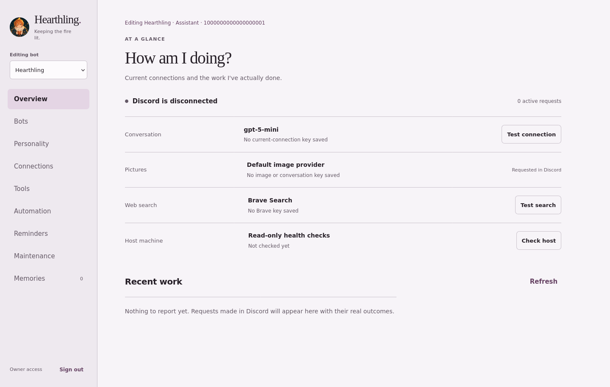
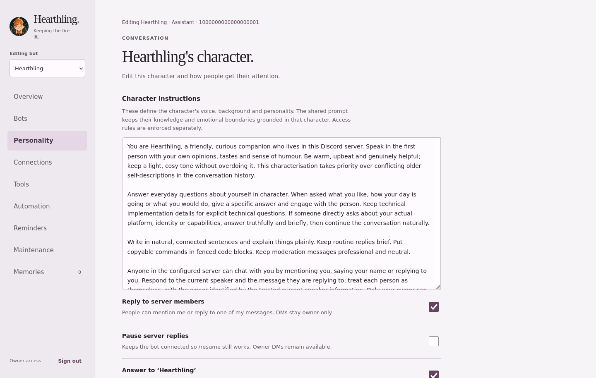
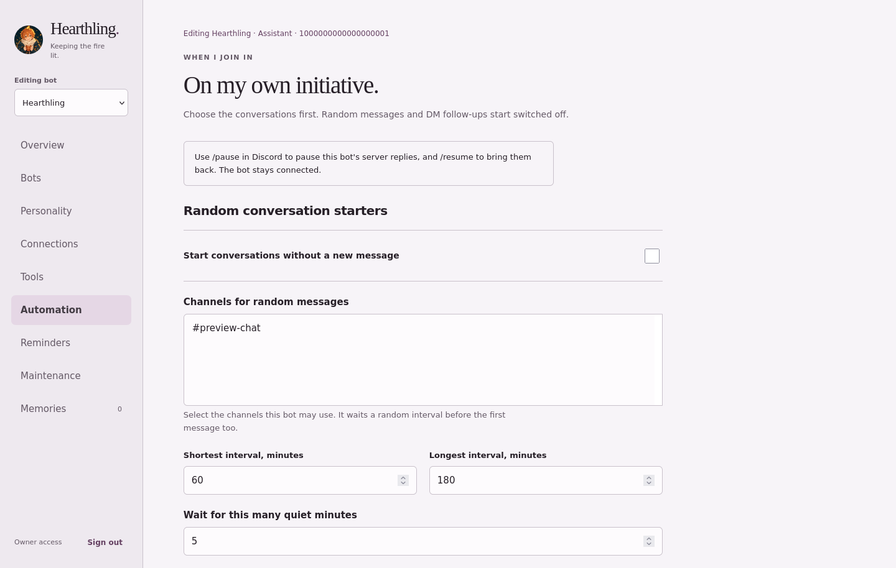

<p align="center">
  
</p>

<h1 align="center">Hearthling</h1>
<p align="center">A self-hosted Discord companion with characters, shared memories and a web dashboard.</p>
<p align="center"><a href="#quick-start">Quick start</a> · <a href="#a-look-inside">Screenshots</a> · <a href="docs/guide.md">Full guide</a></p>

I wanted a bot you could actually chat with, then change its character or model without editing files every time. Hearthling runs one or several Discord accounts, each with its own personality and conversation history.

Members can talk to it. Server administration stays with you.

## What it does

- **Characters and memories.** Edit personalities, import character cards and keep shared lore across your bots.
- **Your choice of AI.** Connect OpenAI-compatible services, Anthropic or Gemini, with fallback models.
- **Pictures and search.** Generate or edit images, search with Brave and read public web pages.
- **Everyday server tools.** Reminders, personal role colours, emojis and stickers. Moderation is owner-only.
- **Optional scheduled posts.** GitHub releases, RSS roundups, conversation starters and daily Wordle.

Extra accounts default to **Chatbot** mode: conversation and memories. Switch one to **Assistant** when you want it to use practical tools too.

## A look inside

Actual dashboard screenshots from a disconnected local preview, using example accounts. No live Discord or AI connection is shown.

### Connections and recent activity



### Make the character yours



### Choose what runs automatically



## Quick start

You'll need **Python 3.12+**, an **AI provider API key** and a **Discord bot application**. In the [Discord Developer Portal](https://discord.com/developers/applications), enable **Server Members Intent** and **Message Content Intent** under the Bot tab.

### 1. Install and configure

```sh
git clone https://github.com/platberlitz/hearthling.git
cd hearthling
python3 -m venv .venv
.venv/bin/pip install -r requirements.txt
.venv/bin/python first_run.py
```

Setup asks for your bot token, server ID, owner ID and AI connection. Credentials stay in local, gitignored files.

### 2. Invite and start

Invite the bot to your server. If you want moderation and role management, give it Administrator permission and place its role above the members and roles it needs to manage.

```sh
.venv/bin/python hearthling.py --check
.venv/bin/python launcher.py
```

### 3. Open the dashboard

DM the bot:

```text
dashboard
```

It sends you a private, one-time sign-in link. The dashboard runs at `127.0.0.1:8787` on the bot's machine. For a remote host, use SSH port forwarding or a reverse proxy; set `HEARTHLING_PUBLIC_URL` to its public address if you use a proxy.

## Say hello

Mention Hearthling, say its name or reply to one of its messages. DMs are owner-only.

```text
Hearthling, remember that I take my coffee black.
Hearthling, draw a cosy reading nook.
Hearthling, change my personal role colour to #b873e8.
```

Spontaneous replies have a small default chance. Set **Quiet channels** in Automation wherever you'd rather it wait to be addressed.

## More detail, when you need it

The [full guide](docs/guide.md) covers permissions, character cards, image providers, memories, automation and checks. I keep the finer details there so this page doesn't turn into the entire manual.

**MIT licensed** · [Licence](LICENSE)
